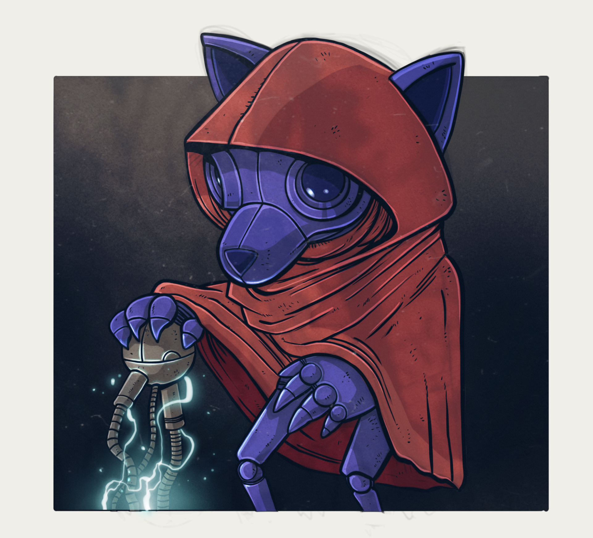

@chapter #ch-variants .dg-guide ch="11"

@page .dg-doc

Chapter 11 {.dg-kicker}

# Variant Gallery

Every element that ships more than one variant, with all of its variants on one stage so they can be compared directly. Each section names the switch that picks the variant; the chapter that documents the element has the full syntax and tokens. Specialty content is the Field Guide's own, excerpted to one ability per card (an ellipsis marks a cut). {.dg-lede}

## Skill trees --- one per specialty

A learning path is a skill tree: the title band, the subtitle, the skill stickers, and the skill cards. The `@specialty` wrapper sets every color and shape, so each tree below is the same markdown under a different class --- and its skill card is that specialty's card. The Dualist and Generalist have no trees of their own: they take their skills from the other eight.

### Augmerc --- `.augmerc`

@specialty .augmerc

@learning-path

### Biting Distance

> If you can touch it, you can maul it. When things get close, they bleed.

- Punishing Counter
- Rage Hit
- Dirty Work

@skill

#### Punishing Counter

> See an opening, ya take it. Best time to hit 'em is when they think it's over.

1. **0 AP** *Steel Says No:* When an enemy in reach makes a basic attack and rolls a **Hard Choice** or worse, your Backbiters knock the strike off line. They miss. ...

@end-skill

@end-learning-path

@end-specialty

### Proxy --- `.proxy`

@specialty .proxy

@learning-path

### Refuse Finality

> Nothing ends while you are still standing.

- Zeal Stitch
- Borrowed Mercy
- Redline Rhythm

@skill

#### Zeal Stitch

> Your zeal is not fury, but light refusing the shadows.

1. **0 AP** You grasp a willing creature in reach or clamp a hand over your own wound, pouring the light of your conviction into the injury as bioluminescent threads stitch flesh together. ROLL THE DIE!

@end-skill

@end-learning-path

@end-specialty

### Streetwarden --- `.streetwarden`

@specialty .streetwarden

@learning-path

### Streetwise

> The more you know the less you carry.

- Gut Sense
- Quick Fix
- Stealth Camp Shroud

@skill

#### Gut Sense

> The alley stinks wrong. The silence is too wide. Something's gonna drop.

1. **0 AP** When you enter a new location---building, block, train car, street---you may ask the Dream Master one question. ... The DM gives you one true insight about the area.

@end-skill

@end-learning-path

@end-specialty

### Gutterdruid --- `.gutterdruid`

@specialty .gutterdruid

@learning-path

### Beastmode

> Some adapt and overcome.

- Feralmorph
- Environmental Assimilation
- Adaptive Mutation

@skill

#### Feralmorph

> You drop into a shape that hides in cracks or hunts the street.

1. **2 AP** Your body rewrites into a natural form, flesh, bone, and instinct taking over. ...

@end-skill

@end-learning-path

@end-specialty

### Cybersurgeon --- `.cybersurgeon`

@specialty .cybersurgeon

@learning-path

### Trauma Economy

> Doctors are sworn to heal the sick but I require a 2000 cred downpayment to uphold my oath.

- Peep and Patch
- Medicated Calm
- Triage Rig

@skill

#### Peep and Patch

> Time is money and your injuries are wasting both!

1. **0 AP** You quickly examine a creature in reach of you and foam wounds shut, staple torn flesh, and flood the pain with emergency chems. Your efforts immediately restore 3 HP but do not remove impairments, heal permanent wounds, or cure diseases.

@end-skill

@end-learning-path

@end-specialty

### Wirephreak --- `.wirephreak`

@specialty .wirephreak

@learning-path

### Professional Courtesy

> Every contract should end clean.

- Dead or Alive
- Killer Instinct
- Hemorrhage

@skill

#### Dead or Alive

> Every alley talks. Every fixer owes somebody. Every bounty leaves a trail. You just know where to start looking.

1. **0 AP** You check darksites, contact fixers, browse bounty boards, and quietly ask around the city's underworld. After a byte or two, you know which bounties are worth chasing, who's offering them, and roughly how dangerous the marks are. ...

@end-skill

@end-learning-path

@end-specialty

### Technosorcerer --- `.technosorcerer`

@specialty .technosorcerer

@learning-path

### Prestidigitalization

> Reality doesn't have to change. You just have to sell the alternative.

- Practical Power
- Digital Chameleon
- Override

@skill

#### Practical Power

> Surprise, amuse, or baffle those around you with a touch of digital magic.

1. **0 AP** You conjure harmless sensory or environmental effects by manipulating cybernetics, technology, or reality itself. Using an Action, you can maintain up to **6 ongoing effects** at once. ...

@end-skill

@end-learning-path

@end-specialty

### Etherlock --- `.etherlock`

@specialty .etherlock

@learning-path

### Mutanthurgy

> Matter, momentum, gravity, flesh. None of them are laws. They're habits. Break them all.

- Rubber Soul
- Skyhook
- Stolen Momentum

@skill

#### Rubber Soul

> Everything bends. Everything bounces. You just gotta convince it.

1. **2 AP** As your Action, you radically increase the elasticity of yourself, one willing packmate, or one surface or object **In Range** until the end of the encounter. ...

@end-skill

@end-learning-path

@end-specialty

## Skill card variants

Every switch on one card, each under the same Augmerc wrapper. `@continue`, which splits a long card across pages, is shown in [The Specialty System](#ch-specialty).

### Default --- `@skill`

Inside a learning path the tier on a card's tab is computed from its position (the skill trees above), unless the heading names one.

@specialty .augmerc

@learning-path

### Example Path

@skill

#### Dirty Work

> Fair fights are for nice mercs who lose.

1. **1 AP** *Street Tricks:* Snag their balance. Gain Lucidity on your next roll against the target.

@end-skill

@end-learning-path

@end-specialty

### Tier override --- `#### Name | AUG1.3`

The tier is written on the heading and printed on the tab.

@specialty .augmerc

@learning-path

### Example Path

@skill

#### Dirty Work | AUG1.3

> Fair fights are for nice mercs who lose.

1. **1 AP** *Street Tricks:* Snag their balance. Gain Lucidity on your next roll against the target.

@end-skill

@end-learning-path

@end-specialty

### Two columns --- `@columns 2` inside a `@skill`

A long ability list packed into two columns. The columns are core's `@columns 2` ... `@end-columns` around just that part of the body; the flavor line and the lead paragraph stay full width.

@specialty .augmerc

@learning-path

### Example Path

@skill

#### Boost Morale | AUG3.4

> When we get outta dis, Imma take whoever has the most kills to the EntD!

When an ally in range ROLLS THE DIE!, bark encouragement that hits just right. Once per round.

@columns 2

1. **2 AP** *Push the Fail:* A Failure becomes a Hard Choice.
2. **1 AP** *Salvage the Choice:* A Hard Choice becomes a Success.
3. **3 AP** *Make It Legend:* A Success becomes a Triumph.
4. **4 AP** *Drag It Up:* A Catastrophe becomes a Hard Choice.

@end-columns

@end-skill

@end-learning-path

@end-specialty

### Outcome table --- a `| Roll | Outcome |` table inside the card

The table becomes the card's outcome ladder.

@specialty .augmerc

@learning-path

### Example Path

@skill

#### Spit Flame | AUG2.1

> Breathe deep. Let it out.

1. **1 AP** *Torch:* Vent a cone of ignited bio-fuel at everything in Reach. ROLL THE DIE!

| Roll | Outcome |
|---|---|
| 20 | Quadruple damage. |
| 11--19 | Double damage. |
| 6--10 | Double damage, but the target counters. |
| 2--5 | You miss. The target counters Lucid. |
| 1 | You fall prone and lose your next turn. |

@end-skill

@end-learning-path

@end-specialty

## AP chips

The plugin picks the chip from the cost written in bold at the start of an ability. The cards are the Augmerc's Dirty Work and the Proxy's Borrowed Mercy (its range line excerpted). The last four registers have no markdown form; they are raw spans. Free is an unlit LED (a grey lens with a hollow lamp and an ink edge: the quietest chip), standard is HUD blue, reduced is pale blue with a down-triangle, increased is blood with an up-triangle, VAR is deep magenta and special is amber: the drawn triangles keep reduced and increased apart in grayscale.

@specialty .augmerc

@learning-path

### Example Path

@skill

#### Dirty Work | AUG1.3

> Fair fights are for nice mercs who lose.

Once per round, outside your turn, you exploit a target in reach:

1. **0 AP** *Off-Hand Insurance:* Slip in a hidden strike that deals 1 damage.
2. **1 AP** *Street Tricks:* Snag their balance. Gain Lucidity on your next roll against the target.
3. **VAR AP** *Break the Read:* ROLL THE DIE! On a hit the target is Dazed; extend it for 1 AP per round.

@end-skill

@end-learning-path

@end-specialty

@specialty .proxy

@learning-path

### Example Path

@skill

#### Borrowed Mercy

> For a moment, suffering looks elsewhere.

1. **2 AP** You invoke your devotion: whether to a deity, an ideal, or a personal creed. Project sustaining force into the fray. You and all nearby allies immediately heal 2 HP.
2. **3-X AP** You may commit more of yourself to the cause when invoking this ability. For each AP spent, increase the healing by +1 HP.

@end-skill

@end-learning-path

@end-specialty

2 AP 1 AP 3 AP SPC

| Chip, in order | You write | Class |
|---|---|---|
| Free | `**0 AP**` | `.dc-ap.free` |
| Standard | `**1 AP**`, `**2 AP**` | `.dc-ap` |
| Variable | `**VAR AP**` | `.dc-ap.variable` |
| Variable | `**3-X AP**`, any range or `X` | `.dc-ap.variable` |
| Standard, explicit | `` | `.dc-ap.standard` |
| Reduced | `` | `.dc-ap.reduced` |
| Increased | `` | `.dc-ap.increased` |
| Special | `` | `.dc-ap.special` |

## Specialty intros

`@specialty-intro` inside each `@specialty`: the same panel, ten title bands. Each band is the specialty's own signal colour with its own register: an LED rim and a rule of LED dots on the tech ones, a faceted plane on the magic ones, a hazard-tape rule on Streetwarden, a torn bottom edge and no rule on Technosorcerer and Gutterdruid. Intro text is the opening of each Field Guide profile.

@specialty .augmerc

@specialty-intro

## Augmerc

An Augmerc is muscle for hire. Street thugs, corporate bodyguards, deniable enforcers --- the difference is gear, grafts, and how much of them is still original.

@end-specialty-intro

@end-specialty

@specialty .proxy

@specialty-intro

## Proxy

Belief burns bright in Dimm City, and Proxies carry the sparks others cannot hold. A word that stops a heart, a prayer that drags a soul back to its feet.

@end-specialty-intro

@end-specialty

@specialty .streetwarden

@specialty-intro

## Streetwarden

Dimm City may look like a concrete jungle, but its sentient population is far outnumbered by the insects, animals, fungi, protista, and monera that thrive throughout its shadowed sprawl. ...

@end-specialty-intro

@end-specialty

@specialty .gutterdruid

@specialty-intro

## Gutterdruid

Nature thrives in Dimm City, but it grows meaner here. It roots in drains, nests in vents, blooms on corpses, cracks through concrete, and feeds on carrion, heat, rust, blood, and whatever the city throws on the curb. ...

@end-specialty-intro

@end-specialty

@specialty .cybersurgeon

@specialty-intro

## Cybersurgeon

Need a new arm? Sit down. Need a neuroimplant wired so the Datasphere crawls behind your eyes? That's extra.

@end-specialty-intro

@end-specialty

@specialty .wirephreak

@specialty-intro

## Wirephreak

The invisible professionals of Dimm City. Corporations, syndicates, governments, and private clients alike rely on Wirephreaks when information must be acquired, facilities infiltrated, witnesses eliminated, or valuable assets extracted without leaving a trace.

@end-specialty-intro

@end-specialty

@specialty .technosorcerer

@specialty-intro

## Technosorcerer

Technosorcerers see the world as one enormous operating system. Magic, cybernetics, matter, even the laws of existence are simply different layers of the same source code waiting to be understood---and rewritten.

@end-specialty-intro

@end-specialty

@specialty .etherlock

@specialty-intro

## Etherlock

Dimm City leaks magic. Raw ether and elements seep through fractures between substantialities, saturating matter and space, feeding the strange ecology of Dimm City itself.

@end-specialty-intro

@end-specialty

@specialty .dualist

@specialty-intro

## Dualist

Dualists refuse to choose. They walk two specialty paths at once, drawing skills from both at the cost of mastery in either.

@end-specialty-intro

@end-specialty

@specialty .generalist

@specialty-intro

## Generalist

Generalists don't specialize --- they scavenge. Picking up scraps of every art the city offers, they're the operative no one expects.

@end-specialty-intro

@end-specialty

## Specialty cards

`@specialty-card` inside each `@specialty`, in a `@card-grid`. Cards alternate `data-position="odd|even"` down the grid.

@card-grid

@columns 2

@specialty .augmerc

@specialty-card

### Augmerc

> Cybernetic Commando

Heavily armed and wired for war, Augmercs are the blunt force of any squad. They charge the front, soak the pain, and unload hell using brute strength and brutal tech. Combat-born, augged to kill, and never outgunned.

@end-specialty-card

@end-specialty

@specialty .proxy

@specialty-card

### Proxy

> Militant Monolith

Marked by something higher---god, ghost, code, or conviction---Proxies walk the line between zealot and judge. They wield divine force like a weapon, bending battles and conversations alike with power that burns louder than faith.

@end-specialty-card

@end-specialty

@specialty .streetwarden

@specialty-card

### Streetwarden

> Sprawl Sentinel

They don't wear badges---they are the law when no one else shows. Streetwardens guard the city's broken places with fists, grit, and a code all their own. They know the alleys like arteries and protect the forgotten.

@end-specialty-card

@end-specialty

@specialty .gutterdruid

@specialty-card

### Gutterdruid

> Wold Witch

They walk the alleys like sacred ground---feeding the hungry, tending weeds, raising the forgotten. Gutterdruids draw power from the pulse beneath the pavement, shaping the raw, primal force that keeps the city alive even as it rots.

@end-specialty-card

@end-specialty

@specialty .cybersurgeon

@specialty-card

### Cybersurgeon

> Mech Medic

Life is flexible. Cybersurgeons prove it daily---cutting, splicing, upgrading flesh into something more. Whether they're back-alley butchers or elite biomech specialists, these med-techs push the edge of evolution, one implant at a time.

@end-specialty-card

@end-specialty

@specialty .wirephreak

@specialty-card

### Wirephreak

> Ping Predator

Killers, thieves, forgers---Wirephreaks specialize in slipping past locks, firewalls, and people. Some work clean, some loud, all lethal. Whether the job calls for stealth, sabotage, or sleight-of-hand, a Wirephreak on the crew means the job gets done.

@end-specialty-card

@end-specialty

@specialty .technosorcerer

@specialty-card

### Technosorcerer

> Modular Magician

Technosorcerers walk on the razor's edge between magic and technology. They believe one to be no different than the other and use the strengths of each to help nullify the other's weaknesses.

@end-specialty-card

@end-specialty

@specialty .etherlock

@specialty-card

### Etherlock

> Manifold Magus

Secrets are currency---and Etherlocks are rich in them. Tapping into elemental forces, spirit echoes, and the buried laws of the monoverse, they wield magic that slips through cracks in reality.

@end-specialty-card

@end-specialty

@specialty .dualist

@specialty-card

### Dualist

> Two-Path Walker

Dualists refuse to choose. They walk two specialty paths at once, drawing skills from both at the cost of mastery in either. Where others sharpen one edge, the Dualist carries two --- equally at home picking locks and pulling triggers, casting circuits and reading rooms.

@end-specialty-card

@end-specialty

@specialty .generalist

@specialty-card

### Generalist

> Sprawl Survivor

Generalists don't specialize --- they scavenge. Picking up scraps of every art the city offers, they're the operative no one expects: a passable hacker who can shoot, a mediocre fighter who can sneak, a half-druid who knows a guy. Master of none. Useful to everyone.

@end-specialty-card

@end-specialty

@end-columns

@end-card-grid

## Class tags

`">`, one per specialty.

Augmerc Proxy Streetwarden Gutterdruid Cybersurgeon Wirephreak Technosorcerer Etherlock Dualist Generalist

## Alerts and callouts

`> [!TYPE]` for one paragraph, `@callout note`, `@callout vibe` and the rest for more --- both emit the same seven registers, and `@callout example` makes an eighth. Each register has its own silhouette, fill value, edge and label: a calm blue note with machined chamfers, a hazard-stripe warning on an octagonal sign plate, an ink Dream Master folder with a tab and a cyan chip, a vibe sheet in a single violet edge with a strip of tape, a torn, dog-eared origin sheet with a worn crimson stamp, the same sheet in map teal for a location, a wobbly green visit signpost, and a ticket-notched cyan example with a taped-on label.

> [!NOTE]
> A character may hold no more than one Signature Augment at a time.

> [!WARNING]
> Trauma Patches stabilize a dying character but do not restore HP.

> [!DM]
> If a player hasn't chosen starting gear by the end of session zero, hand them a Scavenger Pack.

> [!VIBE]
> The rain in Dimm City never quite stops --- it just changes color under the signage.

> [!ORIGIN]
> You didn't choose the street --- the street chose you.

> [!LOCATION]
> The Undercroft: three flooded levels under the old ArkD tower.

> [!VISIT]
> The Neon Bazaar doesn't close.

@callout example

A worked example (`@callout example`, which has no blockquote form): a cyan rail and a taped-on label.

@end-callout

## Blocks

`@block .dc-panel | .dc-slate | .dc-shard`: a HUD-blue band, an ink body under a blood band stamped *Binding*, and light zine paper with a torn foot and no accent hue.

@block .dc-panel label="Panel"

Player-facing rules summaries and structured data.

@end-block

@block .dc-slate label="Slate"

Binding rulings and Dream Master directives.

@end-block

@block .dc-shard label="Shard"

Fiction, atmosphere, and setting asides.

@end-block

## Choice cards

`@card` inside `@flaws`, `@ideals` or `@dreams`. Each kind has its own colour, silhouette and one-word chip: a Flaw is blood with a cracked edge, an Ideal is HUD blue with a steady tablet shape, a Dream is violet with a rising edge. The card name is the first `####`.

@flaws

@card

#### Addictive Personality

You chase instant gratification without weighing the consequences.

> "Just one more, and then I'll quit."

@end-card

@end-flaws

@ideals

@card

#### Honor

You believe in a code, and upholding it is your duty no matter the cost.

> "I made a promise to help those in need, and I'll keep it at all costs."

@end-card

@end-ideals

@dreams

@card

#### Settle a Score

Settle a score from my past. Your Drive should pull you toward trouble, hard choices, and things worth risking your hide for.

> If chasing it can't change you, it ain't big enough.

@end-card

@end-dreams

## Outcome ladder

`@outcome`, then `@outcome flush`. `flush` removes the ladder's outer margin, so the difference is the spacing around it, not the ladder itself.

@outcome

20 | Triumph | Best-case outcome.
11--19 | Success | You do it. Clean.
6--10 | Hard Choice | You succeed, but it costs you.
2--5 | Failure | You don't get what you wanted.
1 | Catastrophe | It goes bad, and then worse.

@end-outcome

@outcome flush

20 | Triumph | Best-case outcome.
11--19 | Success | You do it. Clean.
6--10 | Hard Choice | You succeed, but it costs you.
2--5 | Failure | You don't get what you wanted.
1 | Catastrophe | It goes bad, and then worse.

@end-outcome

## Definition: lucid and surreal

`@definition lucid` and `@definition surreal`, side by side: the two states of a roll, drawn as opposites. Lucid is the light, machined, upright one; surreal is the dark, skewed, off-register one.

@columns 2

@definition lucid

#### Lucid

Roll 2d20, take the higher. You're sharp, aligned, in control. When you roll a 20 in the dream, your next roll is Lucid!

@end-definition

@column-break

@definition surreal

#### Surreal

Roll 2d20, take the lower. Reality pushes back. When you roll a 1 in the dream, your next roll is Surreal.

@end-definition

@end-columns

## Tape

`
...
` is a strip of masking tape: tan, torn ends, ink edges. Then the form with `.dc-flush`, which removes the tape's outer margin.

Operators

Operators

## Stat grid

`
`, then `
`, which removes the block's outer margin.

  

    
Doc Solenn

    
&mdash; Contact · Ripperdoc &mdash;

  

  

    

REP

4

    

HEAT

2

    

FEE

×1.5

    

TURN

-1

  

  

    
Doc Solenn

    
&mdash; Contact · Ripperdoc &mdash;

  

  

    

REP

4

    

HEAT

2

    

FEE

×1.5

    

TURN

-1

  

## Heading chrome

`{.dc-chevron}` is a deep-magenta banner with one diagonal. `{.dc-spray}` is a stencil tag: a stepped overspray edge and a dashed stencil line along its foot. `{.dc-spec-tweak}` is sized to one line, and `{.dc-spec-tweak .dc-no-top}` pulls it tight against what is above.

@section panel

# Augmerc {.dc-chevron}

## Biting Distance {.dc-spray}

### Spec Tweak: Wired to Kill {.dc-spec-tweak}

Augmerc learning paths assume combat-grade augmentations.

### Spec Tweak: Wired to Kill {.dc-spec-tweak .dc-no-top}

@end-section

## Section variants

`@section panel`, `@section flat`, the four kinds of text (`reference`, `lore`, `dm`, `choose`), a bare `@section`, and a panel with its body in `@columns 2`. Each kind has its own bar and sheet as well as its own cut corners: a solid accent bar and one larger chamfer, a pale band and four small even ones, a deep violet bar and long asymmetric slashes, an ink bar under a file-folder tab, and no bar at all on a ticket-notched form.

@section panel

### Panel section

The panel chrome: a cream substrate, an accent rule, a cut top-right corner, and the first heading as a solid accent bar.

@end-section

@section flat

### Flat section

The accent rail on a plain host: no clipped corner, no shadow. A heading prints as a heading, not a bar.

@end-section

@section reference

### Reference section

A look-up: HUD blue, a pale title band, tight rows.

| Item | Cost |
| --- | --- |
| Noodle voucher | 2 DC |
| Signal flare | 15 DC |

@end-section

@section lore

### Lore section

The world, not the rules: a deep violet bar over a pale lilac sheet, with long cuts off two opposite corners.

@end-section

@section dm

### Dream Master section

Behind the screen: a file-folder tab that says Dream Master over an ink bar with a cyan rule, a cold body, a cyan rail and the bottom-right corner cut.

@end-section

@section choose

### Choose section

A pick-one choice for the Citizen File, set as a form: the lightest sheet sunk into the wall, an ink edge, no bar, an ink title over a double rule, tick boxes, dotted write-in rules and a yellow *Choose* stamp:

- A first option.
- A second option.

@end-section

@section panel .dc-avoid-split

### Panel kept whole

`.dc-avoid-split` moves the whole section to the next page rather than splitting it.

@end-section

@section panel

### Section with columns

@columns 2

Dimm City twitches like a clamped nerve at the edge of existence.

@column-break

Nothing here is safe. Nothing here is free.

@end-columns

@end-section

@section

### Bare section

No variant word, no look of its own: the text sits on a plain sheet of paper.

@end-section

## Floated callouts

`@callout note .dc-sidebar` floats beside the text --- see [Layout](#ch-layout).

When the Dreamers push past Too Far, the table starts asking how movement works.

@callout note .dc-sidebar label="Distance, Fast"

Three bands, no grid. **In Reach** is one swing away. **Nearby** is a burned Move.

@end-callout

Keep the bands fictional, not metric. The Dream Master sets the band; the dice decide whether you close it. A Dreamer who wants to cross two bands in one turn is telling you they're willing to spend everything to get there.

## Factions

`@faction megacorp | cabal | cult | enforcer`.

@faction megacorp

#### Megacorp

A hard blue rectangle with a cyan edge: the lights, the water and the lawyers.

@end-faction

@faction cabal

#### Cabal

Violet, with long corner cuts: a back booth and a very long memory.

@end-faction

@faction cult

#### Cult

Blood red, torn along the top and foot: sing the signal and it sings back.

@end-faction

@faction enforcer

#### Enforcer

An octagon with a hazard-tape band and a yellow name label: they keep the peace, for a fee.

@end-faction

@page-break

## Image floats

`{.dc-img-float-left}` and `{.dc-img-float-right}`.

{.dc-img-float-left}

Blasts lit the dusk like glitchfire. Bolts and teeth and claws tangled mid-air. Neon signs cracked. Alleyways bled smoke. Debris rained in bursts.

DimmCitz scattered, vanished into bolted dens and reinforced rooftops.

{.dc-img-float-right}

This wasn't about glory --- it was turf. It was pride. It was blood memory, raw and ugly, of family torn away by their rival.

The air stank of scorched fur, ozone, and cordite.

